# AutoCare AI — Intelligent Vehicle Service & Booking Assistant

[](https://nextjs.org/)
[](https://react.dev/)
[](https://tailwindcss.com/)
[](https://ai.google.dev/)
[](https://www.mongodb.com/)
[](https://clerk.com/)
[](https://www.brevo.com/)
[](https://vercel.com/)

> **AutoCare AI** is an intelligent, full-stack vehicle service assistance and booking-request platform. It combines a text-based AI assistant, a low-latency bidirectional voice assistant powered by Google Gemini Live, authenticated customer dashboards, self-service booking lifecycle management, transactional email updates via Brevo, and automated scheduled maintenance via Vercel Cron.

🌐 **Production Deployment**: [https://autocareai-services.vercel.app/](https://autocareai-services.vercel.app/)

---

## 📌 Problem Statement & Solution

### The Challenge
Booking automotive maintenance traditional channels is often inefficient:
- Customers endure phone hold queues or rigid, inflexible online booking forms.
- Customer support representatives must manually translate vague symptoms into actionable service bay requests.
- Service bookings frequently lack clear confirmation states, leading to uncertainty between a preliminary request and a scheduled bay allocation.
- Inactive, past-dated pending requests clutter administrative queues and databases.

### The AutoCare AI Solution
AutoCare AI streamlines vehicle service operations with a unified, agentic architecture:
- **Multimodal Customer Interaction**: Customers can ask technical questions, diagnose symptoms, and request appointments using natural language via an interactive text chat (Gemini 3.8 Flash) or a real-time voice interface (Gemini Live WebSocket streaming).
- **Authoritative Knowledge Base & Policy Enforcement**: A centralized automotive domain knowledge base and strict escalation/tool policies guarantee consistent responses and explicit customer confirmations before database writes.
- **Robust Booking Lifecycle**: Customers can view booking statuses, reschedule upcoming appointments with client- and server-side date validation, and cancel/delete pending requests directly from their dashboard.
- **Automated Lifecycle Notifications**: Server-side transactional emails automatically notify customers and service center admins of new booking requests, confirmed reschedules, and cancellations using Brevo.
- **Background Maintenance**: A daily serverless cron job purges expired, unconfirmed pending service requests to maintain database hygiene.

---

## ✨ Key Features

| Feature | Description |
| :--- | :--- |
| 💬 **AI Text Assistant** | Interactive chat powered by the Vercel AI SDK and Google Gemini 3.8 Flash with streaming responses and real-time conversation persistence. |
| 🎙️ **Gemini Live Voice Agent** | Direct bidirectional audio streaming over WebSockets using the `@google/genai` SDK (`v1alpha` Bidi connection), 16 kHz PCM audio capture, and client-side response buffering. |
| 🛠️ **Authoritative Tool Calling** | Shared server-side function calling for booking service requests (`createServiceRequest`), requesting phone callbacks (`createCallbackRequest`), and escalating urgent issues to human staff (`escalateToHuman`). |
| 📊 **Customer Dashboard** | Overview of customer profile information, registered vehicle specifications, recent conversation histories, active service requests, and callback requests. |
| 📅 **Self-Service Rescheduling** | Interactive modal to reschedule pending or scheduled appointments with past-date guards, time slot selection, and optimistic local state updates. |
| 🗑️ **Pending Request Deletion** | Safe, authenticated deletion for unconfirmed pending requests with an in-modal confirmation safeguard. |
| 📧 **Transactional Emails** | Event-driven customer receipts, rescheduling updates, cancellations, and administrator notification emails dispatched via the Brevo REST API. |
| ⏰ **Automated Expiry Cleanup** | Protected Vercel Cron endpoint (`/api/cron/cleanup-expired`) that removes expired pending bookings scheduled in the past. |
| 🔒 **Multi-Tenant User Isolation** | Protected routing via Clerk middleware (`proxy.js`) and strict compound queries (`{ _id, clerkId }`) preventing unauthorized data cross-access. |

---

## 🏛️ System Architecture

```mermaid
flowchart TD
    subgraph Client["Frontend Client (Next.js 16 App Router)"]
        Landing["Landing Page (/)"]
        AuthUI["Clerk Auth (/sign-in, /sign-up)"]
        DashboardUI["Customer Dashboard (/dashboard)"]
        ChatUI["AI Chat Session (/session)"]
        VoiceUI["Gemini Live Voice UI (/voice)"]
        ServiceListUI["Service Management (/service-requests)"]
    end

    subgraph Security["Edge & Auth Layer"]
        Proxy["Clerk Middleware (proxy.js)"]
    end

    subgraph Backend["Serverless API Routes & Actions"]
        ChatRoute["/api/chat (Vercel AI SDK)"]
        VoiceTokenRoute["/api/voice/token (Ephemeral Minting)"]
        VoiceToolRoute["/api/voice/tool (Clerk-bound Execution)"]
        ServiceReqRoute["/api/service-requests & [id] (GET, POST, PATCH, DELETE)"]
        CronRoute["/api/cron/cleanup-expired (CRON_SECRET Auth)"]
        ServerActions["Server Actions (Profile & Vehicle Upsert)"]
    end

    subgraph AI["AI Core & Business Logic"]
        SystemPrompt["Authoritative System Prompt & Policies"]
        KnowledgeBase["Automotive Knowledge Base"]
        Tools["Shared Backend Tools (tools.js / voice-tools.js)"]
        GeminiFlash["Google Gemini 3.8 Flash (Text Chat)"]
        GeminiLive["Google Gemini 3.8 Live (v1alpha WebSocket)"]
    end

    subgraph Database["Data Persistence (MongoDB Atlas)"]
        UserModel[("Users Collection")]
        VehicleModel[("Vehicles Collection")]
        ServiceReqModel[("ServiceRequests Collection")]
        ConvModel[("Conversations Collection")]
    end

    subgraph External["Third-Party Services"]
        ClerkService["Clerk Authentication"]
        BrevoService["Brevo Transactional Email API"]
        VercelCron["Vercel Scheduled Cron (01:00 UTC)"]
    end

    %% Client to Security
    Client --> Proxy
    Proxy --> Backend

    %% Backend to AI
    ChatRoute --> SystemPrompt
    ChatRoute --> GeminiFlash
    VoiceTokenRoute --> SystemPrompt
    VoiceTokenRoute --> GeminiLive
    VoiceUI <-->|Bidirectional Audio 16kHz PCM| GeminiLive
    VoiceUI -->|Execute Tool Call| VoiceToolRoute

    %% Business Logic to Tools
    ChatRoute --> Tools
    VoiceToolRoute --> Tools
    SystemPrompt --> KnowledgeBase

    %% Backend to Database
    Tools --> Database
    ServiceReqRoute --> Database
    ServerActions --> Database
    CronRoute --> ServiceReqModel

    %% External Triggers & Notifications
    Tools -.->|Fire-and-Forget Notification| BrevoService
    ServiceReqRoute -.->|Fire-and-Forget Notification| BrevoService
    VercelCron -->|Scheduled GET with Bearer Secret| CronRoute
    AuthUI <--> ClerkService
```



---

## 💻 Tech Stack

### Frontend & UI
- **Framework**: [Next.js 16.3.6](https://nextjs.org/) (App Router, Server Components & Client Components)
- **Library**: [React 19.2.8](https://react.dev/)
- **Styling**: [Tailwind CSS v4](https://tailwindcss.com/) with PostCSS
- **Icons**: [Lucide React](https://lucide.dev/)
- **Visual Identity**: Clean, high-contrast AutoCare theme (Black `#09090B`, White `#FFFFFF`, Accent Orange `#EA580C`, Zinc neutrals)

### AI & Voice
- **Model Provider**: Google Gemini (`gemini-3.8-flash` for text, `gemini-3.8-live` for bidirectional audio)
- **Text Orchestration**: Vercel AI SDK (`ai` v7, `@ai-sdk/google` v4)
- **Voice Orchestration**: `@google/genai` v2.28.0 (configured with `httpOptions: { apiVersion: 'v1alpha' }` for ephemeral tokens and bidirectional WebSockets)
- **Audio Pipeline**: Web Audio API `AudioContext` (16 kHz mono signed 16-bit PCM input, 24 kHz playback)

### Backend & Database
- **Database**: MongoDB with [Mongoose 9.10.2](https://mongoosejs.com/)
- **Schema Validation**: [Zod 4.6.5](https://zod.dev/)
- **Authentication**: [@clerk/nextjs 7.9.7](https://clerk.com/)
- **Email Delivery**: [Brevo Transactional Email API v3](https://www.brevo.com/) via native server-side `fetch`
- **Task Automation**: Vercel Cron via `vercel.json`

---

## 📁 Repository Directory Structure

```text
my-autocare-ai/
├── app/
│   ├── (app)/                          # Authenticated application route group
│   │   ├── conversations/              # Past interaction transcripts & history
│   │   ├── dashboard/                  # Unified customer dashboard overview
│   │   ├── profile/                    # User profile & notification settings
│   │   ├── service-requests/           # Interactive booking management
│   │   │   └── _components/            # ServiceRequestsList, RescheduleDialog, DeleteDialog
│   │   ├── session/                    # Real-time AI text chat interface
│   │   ├── vehicle/                    # Registered vehicle specifications
│   │   └── voice/                      # Gemini Live voice assistance interface
│   ├── (auth)/                         # Authentication route group (Clerk)
│   │   ├── sign-in/[[...sign-in]]/     # Managed sign-in page
│   │   └── sign-up/[[...sign-up]]/     # Managed sign-up page
│   ├── api/                            # Backend REST & webhook routes
│   │   ├── chat/                       # Vercel AI SDK text chat handler
│   │   ├── conversations/              # Conversation CRUD operations
│   │   ├── cron/cleanup-expired/       # Scheduled task for expired pending bookings
│   │   ├── profile/                    # Profile API handler
│   │   ├── service-requests/           # Service request listing & creation
│   │   │   └── [id]/                   # GET, PATCH (reschedule/status), DELETE
│   │   ├── vehicles/                   # Vehicle CRUD operations
│   │   └── voice/
│   │       ├── token/                  # Ephemeral session token minting for Gemini Live
│   │       └── tool/                   # Server-side tool execution for voice agent
│   ├── layout.js                       # Root HTML & ClerkProvider wrapper
│   └── page.js                         # Public marketing landing page
├── components/                         # Shared UI primitives and layouts
│   ├── layout/                         # AppHeader, PageHeader, Sidebar
│   └── ui/                             # Badge, Button, Input, Modal, Skeleton
├── lib/
│   ├── actions/                        # React Server Actions (profile.js, vehicle.js)
│   ├── ai/                             # AI system prompt, tool schemas, and context builders
│   │   ├── prompts/                    # Modular prompt segments (safety, behaviour, policies)
│   │   ├── system-prompt.js            # Authoritative AutoCare AI prompt builder
│   │   ├── tool-definitions.js         # Single source of truth for tool descriptions
│   │   ├── tools.js                    # Text agent tool implementations
│   │   └── voice-tools.js              # Native Gemini function declarations
│   ├── db/
│   │   ├── mongoose.js                 # Global cached MongoDB connection singleton
│   │   └── models/                     # Mongoose schemas: User, Vehicle, ServiceRequest, Conversation
│   ├── email/                          # Brevo transactional email module
│   │   ├── brevo.js                    # Low-level API caller with safe credential handling
│   │   ├── notify.js                   # High-level event dispatcher (create, update, reschedule)
│   │   └── templates.js                # Responsive HTML/text email templates
│   └── knowledge/                      # Authoritative service center business policies & pricing
├── public/                             # Static assets and icons
├── scratch/                            # Standalone validation and test suites
│   └── tools.test.mjs                  # Comprehensive unit tests for AI tools
├── .env.example                        # Documented environment variable template
├── package.json                        # Dependencies, engines, and project scripts
├── proxy.js                            # Clerk edge middleware route matcher (Next.js 16)
└── vercel.json                         # Vercel Cron scheduled job configuration
```

---

## ⚙️ Environment Variables

Copy `.env.example` to `.env.local` in your project root. **Never commit `.env.local` to version control.**

```bash
cp .env.example .env.local
```

### Configuration Reference

| Variable | Required | Description |
| :--- | :---: | :--- |
| `NEXT_PUBLIC_CLERK_PUBLISHABLE_KEY` | **Yes** | Clerk publishable key from your Clerk application dashboard. |
| `CLERK_SECRET_KEY` | **Yes** | Clerk backend secret key for validating server sessions. |
| `NEXT_PUBLIC_CLERK_SIGN_IN_URL` | **Yes** | Relative path to sign-in page: `/sign-in`. |
| `NEXT_PUBLIC_CLERK_SIGN_UP_URL` | **Yes** | Relative path to sign-up page: `/sign-up`. |
| `NEXT_PUBLIC_CLERK_AFTER_SIGN_IN_URL` | **Yes** | Destination path after authentication: `/dashboard`. |
| `NEXT_PUBLIC_CLERK_AFTER_SIGN_UP_URL` | **Yes** | Destination path after registration: `/dashboard`. |
| `CLERK_WEBHOOK_SECRET` | Optional | Webhook secret for Clerk event sync (if using webhooks). |
| `MONGODB_URI` | **Yes** | MongoDB connection string (e.g. Atlas cluster or local instance). |
| `NEXT_PUBLIC_APP_URL` | **Yes** | Base URL of the application (`http://localhost:3000` or production domain). |
| `GOOGLE_GENERATIVE_AI_API_KEY` | **Yes** | API key from Google AI Studio (`AQ...`) powering Gemini models. |
| `GEMINI_MODEL` | **Yes** | Gemini model ID for text chat (defaults to `gemini-3.8-flash`). |
| `GEMINI_LIVE_MODEL` | **Yes** | Gemini model ID for Live voice (defaults to `gemini-3.8-live`). |
| `BREVO_API_KEY` | **Yes** | Transactional API key from Brevo (`xkeysib-...`). |
| `BREVO_SENDER_EMAIL` | **Yes** | Verified sender email address configured in your Brevo account. |
| `BREVO_SENDER_NAME` | **Yes** | Display sender name for emails (e.g., `AutoCare AI`). |
| `ADMIN_NOTIFICATION_EMAIL` | **Yes** | Email address receiving administrative notifications on bookings. |
| `CRON_SECRET` | **Yes** | 32-character secret string protecting `/api/cron/*` endpoints. |

---

## 🚀 Local Development Quickstart

### Prerequisites
- **Node.js**: `v20.x` or higher recommended
- **Package Manager**: `npm` (v10+ or v12+)
- **MongoDB**: A running local MongoDB instance (`mongodb://localhost:27017/AutocareAI`) or a free [MongoDB Atlas](https://www.mongodb.com/atlas) cluster URI.
- **Microphone**: Required for testing the Gemini Live voice interface.

### Installation

1. **Clone the repository**:
   ```bash
   git clone https://github.com/your-username/my-autocare-ai.git
   cd my-autocare-ai
   ```

2. **Install project dependencies**:
   ```bash
   npm install
   ```

3. **Configure your environment**:
   Create a `.env.local` file using `.env.example` as a template and provide your valid development credentials.

4. **Run the local development server**:
   ```bash
   npm run dev
   ```
   Open [http://localhost:3000](http://localhost:3000) in your browser.

> [!TIP]
> **Authentication Note for Local Testing**: Clerk authentication flows and session verification are optimized for production-identical node processes. If you encounter third-party cookie restrictions during local dev mode, run a production build locally:
> ```powershell
> npm run build
> npm run start
> ```

---

## 🧪 Testing & Verification

The project includes unit validation for tool execution and schema conformance:

### 1. Business Logic & Tool Validation Suite
Run the 37-test automated suite covering input schemas, error guards, tool executions, and edge cases:
```bash
node scratch/tools.test.mjs
```
Expected output:
```text
━━━ Section 1: Schema validation ━━━━━━━━━━━━━━━━━━━━━━━━━━
  ✓ createServiceRequest: valid full input
  ✓ createServiceRequest: rejects empty type
  ...
━━━ Section 2: Successful tool calls ━━━━━━━━━━━━━━━━━━━━━━━━
━━━ Section 3: Edge cases ━━━━━━━━━━━━━━━━━━━━━━━━━━━━━━━━━━
━━━ Section 4: Failure paths ━━━━━━━━━━━━━━━━━━━━━━━━━━━━━━━
════════════════════════════════════════════════════════════
  Results: 37/37 passed — all passing
════════════════════════════════════════════════════════════
```

### 2. Code Quality & Linting
Verify ESLint and Next.js rule compliance:
```bash
npm run lint
```

### 3. Production Build Compilation
Verify that all 23 dynamic and static routes compile without bundling errors:
```bash
npm run build
```

---

## 🚢 Deployment

### 1. MongoDB Atlas Setup
1. Create a free cluster on [MongoDB Atlas](https://www.mongodb.com/atlas).
2. Create a database user with read and write permissions to the database.
3. Under **Network Access**, add `0.0.0.0/0` (allow access from anywhere) so serverless functions in Vercel can reach your cluster.
4. Copy the connection string format: `mongodb+srv://<username>:<password>@cluster.xxxx.mongodb.net/autocare-ai?retryWrites=true&w=majority`.

### 2. Vercel Deployment
1. Import your repository into [Vercel](https://vercel.com/).
2. Under **Project Settings → Environment Variables**, add all keys listed in `.env.example`.
3. Set `CRON_SECRET` to a strong random hex string:
   ```bash
   node -e "console.log(require('crypto').randomBytes(32).toString('hex'))"
   ```
4. Deploy the application. Vercel will automatically detect `vercel.json` and schedule the daily cleanup job:
   ```json
   {
     "crons": [
       {
         "path": "/api/cron/cleanup-expired",
         "schedule": "0 1 * * *"
       }
     ]
   }
   ```

---

## 🛡️ Security Architecture

- **No Client-Side Secrets**: All third-party secrets (`GOOGLE_GENERATIVE_AI_API_KEY`, `BREVO_API_KEY`, `CLERK_SECRET_KEY`, `CRON_SECRET`, `MONGODB_URI`) are strictly isolated server-side.
- **Ephemeral Token Minting**: The Gemini Live voice connection never receives the master Google API key; the server issues temporary, constrained tokens via `/api/voice/token` containing hardcoded system prompts and tool restrictions.
- **Compound Query Data Isolation**: Every MongoDB query strictly enforces `{ clerkId: userId }` using the identity verified by Clerk's `auth()`. Clients cannot query or manipulate records belonging to other users.
- **Cron Protection**: The automatic cleanup route validates the incoming request header: `Authorization: Bearer <CRON_SECRET>`.
- **Fault-Tolerant Email Dispatch**: Transactional emails run in non-blocking, fire-and-forget mode with rejections caught internally so third-party email provider outages never corrupt or abort database operations.

---

## 🔮 Future Enhancements

- [ ] **Multi-Vehicle Support**: Support selecting and managing multiple registered vehicles per customer profile.
- [ ] **SMS & WhatsApp Alerts**: Integration with messaging APIs (e.g., Twilio / Meta Cloud API) alongside Brevo email.
- [ ] **Automated 24-Hour Reminders**: Scheduled reminder notifications dispatched 24 hours prior to scheduled appointment dates.
- [ ] **Direct Payment Gateway**: In-app advance payment or deposit collection via Stripe or Razorpay.
- [ ] **Service Bay Calendar Integration**: Direct two-way sync with Google Calendar or service management software.

---

## 📝 Capstone / MVP Notice

**AutoCare AI** was designed and built as an advanced applied AI capstone project demonstrating end-to-end multimodal agent workflows, real-time WebSocket audio processing, database-backed function calling, and full-stack Next.js architecture.

---

## 📄 License

This project is licensed under the [MIT License](LICENSE).
