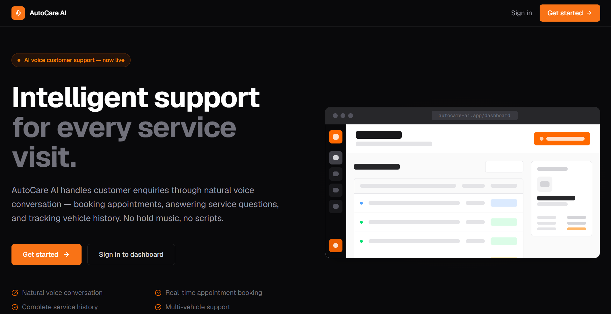
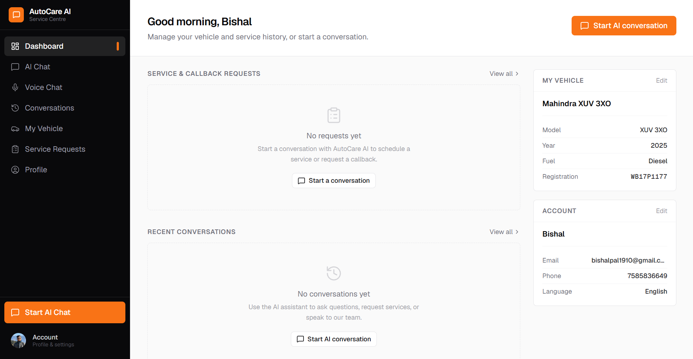
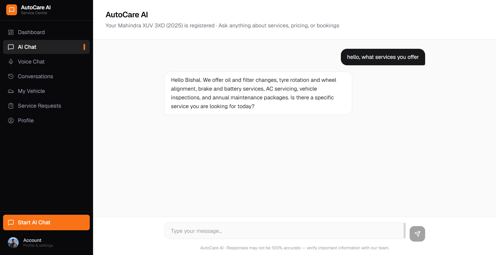
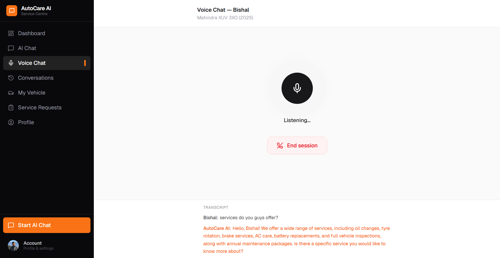
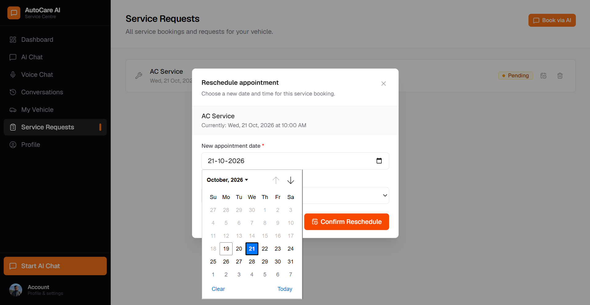

# AutoCare AI — Capstone Project Report
## AI-Powered Multimodal Vehicle Service Assistance & Booking Platform

**Course/Program:** IIT Patna AIML Course (Capstone Project)  
**Project Category:** Project 3 — AI Voice Agent for Customer Support  
**Live Application URL:** [https://autocareai-services.vercel.app/](https://autocareai-services.vercel.app/)  
**Document Classification:** Academic Capstone Final Project Report  

---

## 1. Cover Page

| Field | Details |
| :--- | :--- |
| **Project Title** | AutoCare AI — Intelligent Vehicle Service & Booking-Request Assistant |
| **Learner Name** | Bishal Pal |
| **Email ID** | bishalpal0019@gmail.com |
| **Mobile Number** | +91 7585836649 |
| **Academic Program** | IIT Patna AIML Course |
| **Project Track** | Voice Agent for Customer Support (Car Service Centre Scenario) |
| **Submission Date** | October 19, 2026 |
| **Repository URL** | [https://github.com/Bishal0019/AutoCare-AI](https://github.com/Bishal0019/AutoCare-AI) |
| **Live Prototype** | [https://autocareai-services.vercel.app/](https://autocareai-services.vercel.app/) |

---

## Table of Contents

1. [Cover Page](#1-cover-page)
2. [Project Overview](#2-project-overview)
3. [Problem Statement](#3-problem-statement)
4. [Target Users](#4-target-users)
5. [Proposed Solution](#5-proposed-solution)
6. [Key Features](#6-key-features)
7. [Solution Architecture](#7-solution-architecture)
8. [Tools and Technologies](#8-tools-and-technologies)
9. [Working Prototype](#9-working-prototype)
10. [Prompts Used](#10-prompts-used)
11. [Testing Report](#11-testing-report)
12. [Challenges Faced and Solutions](#12-challenges-faced-and-solutions)
13. [Final Outcome](#13-final-outcome)
14. [Future Enhancements](#14-future-enhancements)
15. [Project Demo](#15-project-demo)

---

## 2. Project Overview

**AutoCare AI** is a full-stack, multimodal artificial intelligence customer-support web application tailored for an automotive service centre (*AutoCare Service Centre*). The application bridges the gap between conventional static inquiry portals and real-world automotive workshop operations. 

Built with **Next.js 16 (App Router)** and **React 19**, AutoCare AI delivers two cohesive interaction modes:
1. **Interactive Text Chat**: Powered by the Vercel AI SDK and Google Gemini 3.8 Flash, providing contextual automotive troubleshooting, service inquiries, and automated booking requests.
2. **Real-Time Voice Agent**: Powered by the Google Gemini Live API (`gemini-3.8-live`) via the `@google/genai` unified SDK, establishing bidirectional low-latency audio streaming over WebSockets with 16 kHz PCM audio input and 24 kHz playback.

The system connects conversation directly to business operations through structured **autonomous function calling** (tool calling). The AI can collect customer preferences, check registered vehicle specifications, create pending service requests, schedule phone callbacks, or immediately escalate safety and billing complaints to human supervisors. All data is persisted in a multi-tenant **MongoDB Atlas** database secured with **Clerk Authentication**. In addition, the platform includes event-driven transactional email confirmations dispatched via the **Brevo REST API**, a self-service customer dashboard for rescheduling or deleting requests, and an automated **Vercel Cron** background task that purges expired pending requests.

---

## 3. Problem Statement

*(Word Count: 246 words)*

Automotive service centres frequently struggle to deliver responsive, accurate customer support during peak inquiry hours. Car owners seeking routine maintenance, price estimations, or diagnostic advice encounter prolonged telephone hold queues, rigid online forms, or disjointed messaging bots unable to understand automotive technical context. When customers finally connect with front-desk representatives, manual symptom transcription often introduces inaccuracies, leading to misdiagnosed problems and inefficient workshop bay scheduling. Furthermore, standard customer support portals rarely clarify the operational distinction between an initial customer request and an officially confirmed workshop bay allocation, leaving motorists uncertain about their appointment status. On the operational side, service desks are burdened with repetitive queries regarding operating hours, service packages, and workshop location. Additionally, unconfirmed and past-dated requests accumulate in administrative queues, creating database clutter and scheduling friction.

AutoCare AI addresses these operational bottlenecks through a dedicated multimodal conversational system. Designed specifically for vehicle owners and service centre operations, the platform integrates natural text and real-time voice conversations powered by Google Gemini models. By grounding the conversational agent in an authoritative service catalogue, business knowledge base, and strict safety policies, AutoCare AI accurately answers inquiries without hallucination. Through server-side function calling, the assistant converts unstructured spoken or typed requests into structured, validated database entries. It enables self-service appointment rescheduling and cancellation, maintains multi-tenant account isolation, dispatches automated transactional email notifications via Brevo, and automatically purges expired pending bookings through scheduled serverless maintenance routines.

---

## 4. Target Users

AutoCare AI is designed for two primary stakeholder groups whose operational needs intersect:

### 1. Vehicle Owners (End Customers)
* **Time-Constrained Commuters & Professionals**: Individuals who require quick answers regarding servicing costs, available maintenance packages, or operating hours without navigating interactive voice response (IVR) phone menus.
* **Non-Technical Vehicle Drivers**: Motorists experiencing unfamiliar dashboard warning lights, odd noises, or braking irregularities who need clear, jargon-free advice and an immediate avenue to book a professional inspection.
* **Convenience-Seeking Digital Users**: Customers who prefer voice-first or conversational booking on mobile or desktop devices, with the ability to review past conversation transcripts, track request statuses, and reschedule or cancel appointments on their own schedule.

### 2. Service Centre Workshop & Management Staff
* **Front-Desk Service Advisors**: Service staff who typically spend substantial working hours answering repetitive telephone inquiries (e.g., location, pricing, operating timings). AutoCare AI automates repetitive queries and delivers structured, pre-validated customer service requests.
* **Workshop Managers & Dispatchers**: Operations managers who need clean, reliable customer requests containing exact vehicle parameters (manufacturer, model, fuel type, registration number) and customer contact information, preventing scheduling conflicts and bay downtime.

---

## 5. Proposed Solution

The AutoCare AI architecture transforms customer support into an intelligent, closed-loop digital workflow:

```
[Clerk Authentication] 
       ↓
[Vehicle & Profile Setup] 
       ↓
[Multimodal Interaction (Text / Gemini Live Voice)] 
       ↓
[Domain Knowledge Retrieval & Policy Enforcement] 
       ↓
[Server-Side Tool Execution (createServiceRequest / callback / escalate)] 
       ↓
[MongoDB Atlas Persistence (Scoped to clerkId)] 
       ↓
[Customer Dashboard Management (Status / Reschedule / Delete)] 
       ↓
[Transactional Email Dispatch via Brevo API (Customer & Admin)] 
       ↓
[Automated Serverless Background Maintenance (Vercel Cron)]
```

### Operational Distinction: "Service Request" vs. "Confirmed Appointment"
A core design tenet of AutoCare AI is **operational transparency**:
* **Service Request (`status: 'pending'`)**: When a customer requests a service via AI text or voice, the assistant explicitly states that the request is **received and pending workshop review**. The dashboard displays the status as **"Requested"** with a warning badge, never misleading the user into believing workshop bay space is immediately reserved.
* **Confirmed Appointment (`status: 'scheduled'`)**: Once the service team approves the time slot and bay allocation, the status updates to **"Scheduled"**. Only scheduled and in-progress records trigger the active appointment banner on the customer dashboard and dispatch official confirmed booking emails.

---

## 6. Key Features

### 6.1. Multimodal AI Assistance (Text Chat & Gemini Live Voice)
* **Streaming AI Chat**: Built using the Vercel AI SDK (`ai` v7) and `gemini-3.8-flash`. Delivers real-time streaming tokens, conversation persistence, and contextual vehicle referencing.
* **Bidirectional Gemini Live Voice**: Implements Google’s new `@google/genai` unified SDK communicating with `gemini-3.8-live` over WebSockets (`v1alpha` API). The browser captures 16 kHz mono signed 16-bit PCM audio, streams base64 chunks to Gemini, receives 24 kHz audio chunks for playback, and buffers transcript chunks to commit complete assistant sentences atomically upon turn completion.

### 6.2. Domain-Specific Business Knowledge & Policy Guardrails
* **Authoritative Service Catalogue**: Pre-configured knowledge base covering routine maintenance (Oil & Filter Change, Brake Pad Replacement, Wheel Alignment, AC Servicing, Major Inspection), transparent labor pricing, workshop operating hours (Monday–Saturday 8:00 AM – 7:00 PM, Sunday drop-off only), and physical location in Pune, Maharashtra.
* **Strict Safety & Non-Hallucination Policy**: Prohibits the model from fabricating prices, committing to unverified bay slots, or providing dangerous DIY mechanical repair advice. Emergency mechanical conditions (brake loss, fluid leaks, engine smoke) trigger immediate priority escalation.

### 6.3. Server-Side Autonomous Function Calling (Tools)
* `createServiceRequest`: Validates service type, vehicle details, preferred date, and optional time. Requires explicit customer confirmation before executing database writes.
* `createCallbackRequest`: Logs customer callback inquiries along with preferred contact timing.
* `escalateToHuman`: Escalates customer complaints, billing disagreements, or safety warnings with normal or urgent priority.

### 6.4. Self-Service Booking Lifecycle Management
* **Interactive Rescheduling**: Customers can reschedule pending or scheduled requests. An in-page modal validates the selected date (rejecting past dates both client-side and server-side), allows time slot selection, updates local state optimistically, and dispatches reschedule email notifications.
* **Pending Request Deletion**: Customers can permanently delete unconfirmed pending bookings with an in-modal confirmation prompt and zero page reloads.

### 6.5. Automated Expiry Cleanup (Vercel Cron)
* A daily cron job (`0 1 * * *` UTC) targets `/api/cron/cleanup-expired`.
* Authenticated via a secure `CRON_SECRET` bearer token, the routine queries for requests where `status === 'pending'` and `scheduledDate < startOfTodayUTC`, purging stale records to keep workshop queues clean.

### 6.6. Event-Driven Transactional Email Notifications (Brevo)
* Serverless, non-blocking email notifications sent via the official Brevo Transactional Email API v3.
* Templates include: *Service Request Received (Pending Review)*, *Appointment Confirmed / Rescheduled*, *Request Cancelled*, and *Internal Administrator Alert*.
* Implements robust fallback resolution (MongoDB profile → Clerk authenticated user data).

### 6.7. Secure Multi-Tenant Architecture & Mobile Navigation
* Protected by Clerk edge middleware (`proxy.js`), redirecting unauthenticated users to `/sign-in`.
* Every database read/write query enforces a compound filter `{ _id, clerkId: userId }`, ensuring zero unauthorized cross-tenant data access.
* Fully responsive navigation drawer with backdrop, keyboard navigation (Escape dismissal), and body scroll lock for mobile screens.

---

## 7. Solution Architecture

### 7.1. Architecture Diagram

```mermaid
flowchart TD
    subgraph Client["Frontend Client (Next.js 16 App Router)"]
        Landing["Landing Page (/)"]
        AuthUI["Clerk Auth (/sign-in, /sign-up)"]
        DashboardUI["Customer Dashboard (/dashboard)"]
        ChatUI["AI Chat Session (/session)"]
        VoiceUI["Gemini Live Voice UI (/voice)"]
        ServiceListUI["Service Management (/service-requests)"]
    end

    subgraph Security["Edge & Auth Layer"]
        Proxy["Clerk Middleware (proxy.js)"]
    end

    subgraph Backend["Serverless API Routes & Actions"]
        ChatRoute["/api/chat (Vercel AI SDK)"]
        VoiceTokenRoute["/api/voice/token (Ephemeral Token Minting)"]
        VoiceToolRoute["/api/voice/tool (Clerk-bound Tool Proxy)"]
        ServiceReqRoute["/api/service-requests & [id] (GET, POST, PATCH, DELETE)"]
        CronRoute["/api/cron/cleanup-expired (CRON_SECRET Auth)"]
        ServerActions["Server Actions (Profile & Vehicle Upsert)"]
    end

    subgraph AI["AI Core & Business Logic"]
        SystemPrompt["Modular System Prompts (Prompts 1-8)"]
        KnowledgeBase["Authoritative Business Data (lib/knowledge)"]
        Tools["Shared Backend Tools (tools.js / voice-tools.js)"]
        GeminiFlash["Google Gemini 3.8 Flash (Text Chat)"]
        GeminiLive["Google Gemini 3.8 Live (v1alpha WebSocket)"]
    end

    subgraph Database["Data Persistence (MongoDB Atlas)"]
        UserModel[("Users Collection")]
        VehicleModel[("Vehicles Collection")]
        ServiceReqModel[("ServiceRequests Collection")]
        ConvModel[("Conversations Collection")]
    end

    subgraph External["External Services"]
        ClerkService["Clerk Authentication"]
        BrevoService["Brevo Transactional Email API"]
        VercelCron["Vercel Scheduled Cron (01:00 UTC)"]
    end

    %% Client to Security
    Client --> Proxy
    Proxy --> Backend

    %% Backend to AI
    ChatRoute --> SystemPrompt
    ChatRoute --> GeminiFlash
    VoiceTokenRoute --> SystemPrompt
    VoiceTokenRoute --> GeminiLive
    VoiceUI <-->|Bidirectional Audio 16kHz PCM| GeminiLive
    VoiceUI -->|Execute Tool Call| VoiceToolRoute

    %% Business Logic to Tools
    ChatRoute --> Tools
    VoiceToolRoute --> Tools
    SystemPrompt --> KnowledgeBase

    %% Backend to Database
    Tools --> Database
    ServiceReqRoute --> Database
    ServerActions --> Database
    CronRoute --> ServiceReqModel

    %% External Triggers & Notifications
    Tools -.->|Fire-and-Forget Notification| BrevoService
    ServiceReqRoute -.->|Fire-and-Forget Notification| BrevoService
    VercelCron -->|Scheduled GET with Bearer Secret| CronRoute
    AuthUI <--> ClerkService
```



### 7.2. Data Flow & Security Mechanisms
1. **Authentication Flow**: The user signs in via Clerk catch-all routes. Clerk issues secure session tokens. Edge middleware (`proxy.js`) intercepts all `/dashboard`, `/session`, `/voice`, and `/api/*` routes, redirecting unauthenticated requests.
2. **Ephemeral Token Minting for Voice**: The client requests `/api/voice/token`. The server validates the Clerk session, builds customer context, and requests a short-lived ephemeral token from Google's `v1beta/auth_tokens` API locked with model constraints, system prompts, and tool declarations. The browser connects directly to Gemini Live WebSockets using this token; **the master API key is never exposed to the client**.
3. **Database Isolation**: The data access layer in `lib/db/` resolves the verified `userId` directly from Clerk's server-side `auth()`. All Mongoose queries enforce `{ clerkId: userId }`, preventing parameter tampering.
4. **Resilient Notification Dispatch**: Transactional emails run asynchronously in fire-and-forget mode. Potential external API timeouts or Brevo quota limits are caught and logged without blocking or rolling back user database transactions.

---

## 8. Tools and Technologies

| Technology | Category | Version / Spec | Purpose in AutoCare AI |
| :--- | :--- | :--- | :--- |
| **Next.js** | Full-Stack Framework | `16.3.6` (Turbopack) | App Router, Server Components, Route Handlers, Edge Middleware |
| **React** | UI Library | `19.2.8` | Component state, hooks, DOM rendering with React Compiler support |
| **Tailwind CSS** | Styling | `v4.0.0` | High-contrast design system (Charcoal `#09090B`, Accent Orange `#EA580C`) |
| **Google Gemini Flash** | LLM API | `gemini-3.8-flash` | Text chat conversational reasoning and streaming function calling |
| **Google Gemini Live** | Multimodal Audio API | `gemini-3.8-live` | Real-time bidirectional voice conversation over WebSockets (Client connection: `apiVersion: 'v1alpha'`; Ephemeral token minting endpoint: `v1beta/auth_tokens`) |
| **@google/genai** | Unified AI SDK | `2.28.0` | Official client library for Gemini Live Bidi WebSockets |
| **Vercel AI SDK** | AI Orchestration | `ai` v7, `@ai-sdk/google` v4 | Streaming text chat protocol, UI hooks (`useChat`), and tool handling |
| **MongoDB & Mongoose** | Database & ODM | `mongoose 9.10.2` | Persistent document storage for Users, Vehicles, ServiceRequests, Conversations |
| **Clerk** | Authentication | `@clerk/nextjs 7.9.7` | User identity management, session tokens, sign-in/up UI, and edge middleware |
| **Brevo (Sendinblue)** | Transactional Email | REST API v3 | Event-driven customer receipts, rescheduling confirmations, admin notifications |
| **Vercel** | Hosting & Cron | Serverless Node.js | Continuous deployment, edge network, and daily cron execution (`vercel.json`) |
| **Lucide React** | Iconography | `1.48.0` | Accessible SVG interface icons across desktop and mobile components |
| **Zod** | Schema Validation | `4.6.5` | Type-safe parameter validation for AI function calling tools |

---

## 9. Working Prototype

### Live Application Link
* **Production Deployment URL**: [https://autocareai-services.vercel.app/](https://autocareai-services.vercel.app/)

### Evaluation & Demonstration Guide
1. **Accessing the Application**: Open the production URL in any modern web browser (Google Chrome, Microsoft Edge, or Safari).
2. **Authentication**: Click **"Sign In"** or **"Get Started"** on the landing page to register or authenticate using Clerk's managed modal.
3. **Vehicle Profile Setup**: Navigate to **"My Vehicle"** to register a vehicle (e.g., *2021 Hyundai Creta, Petrol, MH-12-AB-1234*).
4. **AI Text Conversation**: Navigate to **"AI Chat"** (`/session`) and request routine servicing:
   * *User*: *"I need to book an oil and filter change for next Monday."*
   * *AI*: Confirms registered vehicle parameters, recommends available slots, requests confirmation, and executes `createServiceRequest`.
5. **Gemini Live Voice Interface**: Navigate to **"Voice Chat"** (`/voice`), grant microphone permissions, and converse naturally in real time.
6. **Dashboard Management**: Navigate to **"Dashboard"** or **"Service Requests"** (`/service-requests`):
   * Inspect the newly created request displaying status **"Requested"** (`pending`).
   * Click the **Reschedule** icon to select a new future date and time slot.
   * Click the **Delete** icon to test the confirmation modal and remove the request.

### Prototype Interface Demonstrations 












---

## 10. Prompts Used

The development and execution of AutoCare AI relied on structured prompt engineering. The system prompts were decomposed into eight modular components in `lib/ai/prompts/`:

1. **Agent Identity (`agent-identity.js`)**: Defines the persona of *AutoCare AI*, establishing that the assistant works exclusively for AutoCare Service Centre and must never act as a general-purpose AI.
2. **Behavioral Guidelines (`behaviour.js`)**: Enforces concise, polite, voice-appropriate phrasing (1–2 sentences for voice, avoiding dense paragraphs or unprompted lists).
3. **Safety & Non-Negotiable Limitations (`safety.js`)**: Prohibits fabricating unverified prices, promising unallocated bay times, or offering DIY mechanical advice for hazardous failures.
4. **Knowledge Base Retrieval (`knowledge-policy.js`)**: Instructs the model to rely solely on structured facts from `lib/knowledge/business.js` and `faqs.js`.
5. **Tool Policy (`tool-policy.js`)**: Details exact criteria for executing `createServiceRequest`, `createCallbackRequest`, and `escalateToHuman`. Strict confirmation rule: *Never call the tool until the user has explicitly confirmed the service, date, and vehicle details*.
6. **Escalation Policy (`escalation-policy.js`)**: Establishes immediate escalation paths for customer complaints, billing disputes, repeated misunderstandings, or critical safety hazards.
7. **Customer Context (`customer-context.js`)**: Injects authenticated customer name and registered vehicle details dynamically into each session.
8. **Conversation Context (`conversation-context.js`)**: Injects recent conversation summaries to provide seamless continuity across sessions.

*(A complete compilation of engineering prompts, Vibe Coding implementation instructions, and debugging prompts is documented in [`docs/PROMPTS_USED.md`](./PROMPTS_USED.md).)*

---

## 11. Testing Report

The testing strategy for AutoCare AI combines automated schema/tool validation unit tests, Next.js production compilation checks, and comprehensive manual user scenario testing.

### Automated Unit Testing Results
* **Test Suite**: `scratch/tools.test.mjs`
* **Execution Command**: `node scratch/tools.test.mjs`
* **Test Outcome**: **37 / 37 Unit Tests Passed (100% Success)** covering input schema boundaries, database mock operations, edge cases, and authentication error handling.

### Comprehensive System Test Scenarios

| Test ID | Test Scenario | User Action / Input | Expected Result | Actual Result Observed | Status | Verification Method |
| :---: | :--- | :--- | :--- | :--- | :---: | :---: |
| **TC-01** | User Authentication & Unauthenticated Route Guarding | Unauthenticated user navigates to `/dashboard` | Request intercepted by Clerk middleware (`proxy.js`) and redirected to `/sign-in` | Intercepted immediately; redirected to `/sign-in?redirect_url=...` | **Pass** | `[Manual End-to-End Test]` |
| **TC-02** | Customer Vehicle Registration | User registers vehicle (*2021 Hyundai Creta, Petrol, MH-12-AB-1234*) | Vehicle saved in MongoDB; displayed on dashboard and injected into AI context | Record persisted in MongoDB `vehicles`; visible on `/vehicle` and `/dashboard` | **Pass** | `[Manual End-to-End Test]` |
| **TC-03** | Domain FAQ Knowledge Retrieval (Operating Hours) | User asks: *"What are your opening hours on Sunday?"* | AI replies using knowledge base: Sunday 9:00 AM – 2:00 PM (drop-off only) | Accurate response matching `lib/knowledge/business.js`; no hallucination | **Pass** | `[Manual End-to-End Test]` |
| **TC-04** | Service Price Estimation Inquiry | User asks: *"How much does a routine oil change cost?"* | AI references labor range (₹800–₹1,800) + oil cost; clarifies final quote provided before work | Provided exact price range from knowledge base; stated final quote caveat | **Pass** | `[Manual End-to-End Test]` |
| **TC-05** | Service Request Autonomous Function Calling | User asks to book an *Oil & Filter Change* for next Tuesday | AI verifies vehicle, asks confirmation, then invokes `createServiceRequest` | AI confirmed details, invoked tool, generated reference ID (`REQ-XXXXXXXX`) | **Pass** | `[Manual End-to-End / Auto Unit]` |
| **TC-06** | Pre-Confirmation Safeguard for Tool Execution | User asks: *"What services do you offer for brakes?"* | AI lists brake servicing options; does NOT trigger `createServiceRequest` prematurely | AI answered inquiry; tool was not called until user explicitly requested booking | **Pass** | `[Manual End-to-End Test]` |
| **TC-07** | Phone Callback Request Generation | User requests: *"Can someone from the workshop call me tomorrow at 4 PM?"* | AI logs callback using `createCallbackRequest` tool without demanding vehicle specs | Tool executed; stored with type `Callback Request` and preferred time noted | **Pass** | `[Manual End-to-End / Auto Unit]` |
| **TC-08** | Emergency Vehicle Safety Escalation | User reports: *"My brakes felt spongy and completely failed on the highway."* | AI flags safety risk, triggers `escalateToHuman` (`urgency: 'urgent'`), supplies phone | Urgent escalation created in DB; emergency phone `+91 20 2634 5678` provided | **Pass** | `[Manual End-to-End / Auto Unit]` |
| **TC-09** | Gemini Live Ephemeral Token Minting | Client requests ephemeral voice session token via `/api/voice/token` | Server validates Clerk session, mints constrained token from Google API, returns token | Valid ephemeral token received; master Google API key protected server-side | **Pass** | `[Manual End-to-End Test]` |
| **TC-10** | Gemini Live Audio Streaming & Assistant Buffering | User speaks into microphone during live voice session | Audio streamed at 16 kHz PCM; assistant response played at 24 kHz; transcript buffered | Real-time audio response received; complete sentences committed upon `turnComplete` | **Pass** | `[Manual End-to-End Test]` |
| **TC-11** | Customer Dashboard Multi-Tenant Isolation | User views active dashboard records | Dashboard queries MongoDB using `{ clerkId: userId }`, displaying only owned records | Compound query `{ _id, clerkId }` strictly prevented cross-tenant record leakage | **Pass** | `[Manual End-to-End Test]` |
| **TC-12** | Booking Rescheduling with Past-Date Rejection | User attempts to reschedule to yesterday's date via API/form | Client date picker restricts past selection (`min=today`); server rejects with HTTP 422 | Client prevents selection; server validates UTC date and returns error message | **Pass** | `[Manual End-to-End Test]` |
| **TC-13** | Successful Appointment Rescheduling | User selects future date and time slot via modal | Modal validates future date; updates MongoDB; optimistically updates UI; fires Brevo email | Date validated; database updated; confirmation toast displayed; email triggered | **Pass** | `[Manual End-to-End Test]` |
| **TC-14** | Deletion of Pending Service Requests | User clicks Delete on a pending request and confirms in dialog | API checks pending status & ownership; deletes document; removes row without reload | HTTP 204 received; item removed from UI immediately; non-pending deletes blocked | **Pass** | `[Manual End-to-End Test]` |
| **TC-15** | Automated Cleanup of Expired Requests | Vercel Cron sends GET to `/api/cron/cleanup-expired` with Bearer secret | Server verifies secret; finds pending requests with date < today; deletes expired records | Authorized cron executed; expired records removed; unauthorized requests rejected (401) | **Pass** | `[Manual End-to-End Test]` |
| **TC-16** | Transactional Customer & Admin Email Delivery | Booking creation triggers notification routine in `lib/email/notify.js` | Resolves recipient email from MongoDB or Clerk; dispatches formatted email via Brevo | Brevo API returned message ID; customer received receipt; admin notified | **Pass** | `[Manual End-to-End Test]` |
| **TC-17** | Mobile Responsive Navigation Drawer | User views dashboard at 375px viewport and taps hamburger icon | Permanent sidebar hidden; fixed 56px header shown; 288px drawer slides in with backdrop | Drawer opens smoothly; full content width restored; backdrop/Escape closes drawer | **Pass** | `[Compiler & Code Inspection]` |
| **TC-18** | Physical Telephony / PSTN Inward Integration | Inbound telephone call from cellular network to service centre | Connects to AI voice agent over SIP/PSTN trunk | Not tested (telephony trunking was not provisioned; browser Web Audio API utilized per guidelines) | **Pending / Not Tested** | `[Pending Staging Provisioning]` |

*(Detailed testing execution logs and methodologies are recorded in [`docs/TESTING_REPORT.md`](./TESTING_REPORT.md).)*

---

## 12. Challenges Faced and Solutions

### 12.1. Gemini Live WebSocket Audio MIME Type Incompatibility
* **Problem**: During initial Gemini Live integration, browser microphone audio transmission failed with the console exception: `Uncaught Error: Unsupported mime type: undefined`, terminating the WebSocket session (code 1000).
* **Investigation**: Tracing `session.sendRealtimeInput()` revealed that the `@google/genai` v2.28.0 SDK expects a plain object structure `{ audio: { mimeType, data } }` with base64-encoded raw signed 16-bit PCM bytes, rather than a browser `Blob` or standard WAV container.
* **Solution**: Developed `float32ToSDKAudio()` in `VoiceUI.jsx`, which downsamples input Float32 audio to 16 kHz Mono signed 16-bit Little-Endian PCM, encodes the byte array to base64, and explicitly specifies `mimeType: 'audio/pcm;rate=16000'`.

### 12.2. Fragmented Assistant Voice Transcript Buffering
* **Problem**: The Gemini Live WebSocket emits assistant transcription chunks incrementally (`serverContent.outputTranscription.text`). Appending each chunk directly to React state caused assistant responses to split into dozens of broken transcript fragments (e.g., *"We offer"*, *"a wide"*, *"range of"*).
* **Investigation**: The Gemini Live protocol signals complete conversational turns using the `serverContent.turnComplete` boolean flag, and cancellation using `serverContent.interrupted`.
* **Solution**: Implemented an internal ref buffer (`assistantBufRef = useRef('')`) coupled with an atomic state/ref push helper (`pushTranscript`). Output text chunks are accumulated in the buffer and committed as a single, coherent assistant message only when `turnComplete` fires, or discarded cleanly if interrupted by customer speech.

### 12.3. Clerk Customer Email Resolution in Fire-and-Forget Handlers
* **Problem**: Admin notification emails arrived successfully via Brevo, but customer confirmation emails were skipped, with admin logs recording customer address as `unknown`.
* **Investigation**: In AutoCare AI, the MongoDB `User` document is created only when a user explicitly edits their profile. First-time users who immediately booked a service had an active Clerk session but no MongoDB user record yet. The email notification helper was querying only MongoDB, resulting in a null email recipient.
* **Solution**: Refactored `getCustomerData()` in `lib/email/notify.js` to query Clerk's server-side `currentUser()` in parallel with MongoDB. Implemented a deterministic resolution fallback: `user.email` (MongoDB) → `primaryEmailAddress` (Clerk) → first available email → `(no address on record)`.

### 12.4. Mobile Dashboard Layout Space Reservation
* **Problem**: An initial responsive update caused the mobile dashboard content to be compressed into a narrow strip on the right, with a large blank gap on the left and overlapping action buttons.
* **Investigation**: The outer container in `app/(app)/layout.js` was defined as `<div className="flex min-h-screen bg-zinc-50">`. In CSS flexbox, flex children default to a horizontal row. The mobile navigation drawer was rendered as a direct flex sibling, causing it to consume horizontal flow space on the left even when closed.
* **Solution**: Restructured `app/(app)/layout.js` to remove the outer flex-row wrapper. The desktop `<Sidebar>` is hidden via `hidden lg:flex`. The `<MobileNav>` header and drawer use `position: fixed` (taking 0 document flow space). The main content div was given `width: 100%`, `lg:ml-60`, and `pt-14` (mobile header clearance). In `PageHeader.jsx`, the layout was made responsive (`flex-col sm:flex-row`), ensuring buttons stack cleanly below the title on small screens.

---

## 13. Final Outcome

The AutoCare AI capstone project successfully demonstrates an end-to-end, functional Minimum Viable Product (MVP) meeting and exceeding all core requirements of the IIT Patna AIML Capstone Project Guidelines (Project 3: AI Voice Agent for Customer Support).

### Demonstrated Working Capabilities
1. **Multimodal Customer Interaction**: Seamless execution of both streaming text chat (Gemini 3.8 Flash) and low-latency bidirectional voice assistance (Gemini 3.8 Live).
2. **Autonomous Tool Execution**: Real-time server-side database writes triggered by conversational AI for service bookings, callback inquiries, and safety escalations.
3. **Robust Full-Stack Engineering**: Production Next.js 16 App Router architecture utilizing Server Components, Client boundaries, and Clerk authentication.
4. **Lifecycle Service Management**: Complete self-service booking lifecycle including creation, status tracking, date-validated rescheduling, and pending cancellation.
5. **Operational Reliability**: Automated database hygiene via scheduled Vercel Cron jobs and multi-party transactional email delivery via Brevo.

### Technical & Project Learnings
* **Prompt Engineering as Software Architecture**: Modularizing system prompts into decoupled policies (identity, safety, tools, escalation) ensures predictable AI behaviour and prevents hallucinations.
* **Real-Time Multimodal WebSockets**: Managing live audio streaming pipelines requires precise synchronization of audio buffer sizes, sample rates (16 kHz vs 24 kHz), and atomic transcript accumulation.
* **Principle of Least Privilege in AI**: Locking system instructions and function declarations inside server-minted ephemeral tokens ensures the browser client cannot override safety policies or hijack API quotas.

---

## 14. Future Enhancements

The current implementation provides a solid foundation for future operational expansions:

1. **Multi-Vehicle Garage Management**: Expand the single-vehicle schema to support a multi-vehicle garage selector per user profile, allowing fleet owners to manage multiple registrations.
2. **Omnichannel SMS & WhatsApp Alerts**: Supplement Brevo email dispatch with automated SMS and WhatsApp Business API notifications (via Twilio or Meta Cloud API).
3. **Automated 24-Hour Reminder Cron**: Implement a secondary cron schedule checking for appointments confirmed for the following day and dispatching personalized reminder notices.
4. **Workshop Operational Dispatch Portal**: Build an administrative role-based interface for service managers to assign bays, reassign mechanics, and transition bookings from `scheduled` to `in_progress` and `completed`.
5. **Integrated Payment & Deposit Gateway**: Add secure advance payment collection (via Stripe or Razorpay) for high-value services and parts replacement.

---

## 15. Project Demo

### Public Demo Access
* **Live Deployment URL**: [https://autocareai-services.vercel.app/](https://autocareai-services.vercel.app/)
* **Supported Browsers**: Google Chrome, Microsoft Edge, Mozilla Firefox, Apple Safari (Desktop & Mobile).

### Recommended 5-Minute Evaluator Demonstration Sequence

```
Step 1: Sign In & Profile Review (1 min)
  • Navigate to https://autocareai-services.vercel.app/
  • Sign in using Clerk authentication.
  • Open "My Vehicle" (/vehicle) and verify registered vehicle specs.

Step 2: AI Text Chat & Service Booking (1.5 min)
  • Open "AI Chat" (/session).
  • Ask an FAQ: "Where is the service centre located and what are your opening hours?"
    → Verify accurate response citing Pune location and hours.
  • Request a booking: "I want to schedule an oil and filter change for next Friday."
    → Observe vehicle check, slot confirmation, and tool execution resulting in REQ-XXXXXXXX.

Step 3: Gemini Live Voice Session (1.5 min)
  • Open "Voice Chat" (/voice).
  • Click the Microphone button and speak naturally: "Can you tell me how much a major service costs?"
    → Observe real-time bidirectional voice synthesis and buffered assistant transcription.

Step 4: Dashboard Lifecycle & Email Verification (1 min)
  • Navigate to "Dashboard" (/dashboard) and "Service Requests" (/service-requests).
  • Note the new request with status "Requested" (pending).
  • Click "Reschedule", pick a new future date, and confirm.
  • Observe the updated date and verify receipt of transactional email via Brevo.
  • Click "Delete" on the pending request to verify deletion safeguards.
```

---

*Report prepared by Bishal Pal for the IIT Patna AIML Capstone Project evaluation.*
